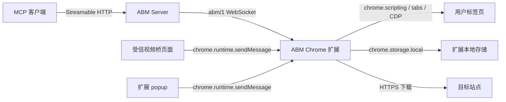
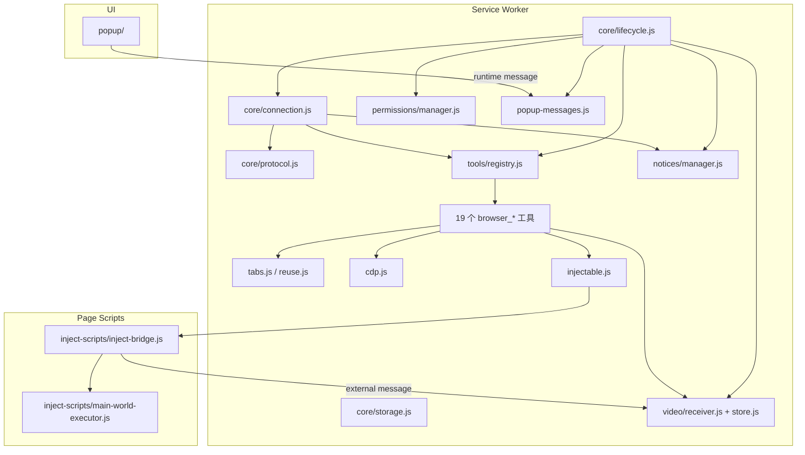

# ABM 浏览器扩展架构设计

> 本文定义 `browser-mcp-extension` 的系统边界、组件和公开契约。实现细节、时序图和操作示例见 [detailed-design.md](detailed-design.md)、[data-flow.md](data-flow.md)、[scenarios.md](scenarios.md)。

## 1. 定位

ABM 是 **a browser mcp** 的简称。本仓库是 ABM 的 Chrome 扩展端：

- 把用户自己的浏览器接入 ABM 服务。
- 通过 `abm/1` WebSocket 接收已认证的工具调用。
- 在用户本机执行标签、DOM、CDP、上传、网络和视频操作。
- 不保存账号密码或账号会话 Cookie。
- 不实现服务端账号、MCP 或 OAuth；这些属于 `browser-mcp-server`。

## 2. 系统上下文



信任边界：

1. **服务端边界**：扩展只信任已配置的 ABM 服务地址和有效 API Key。
2. **页面边界**：注入脚本只作用于被工具指定的标签页；页面内容不可信。
3. **桥边界**：只有 `manifest.externally_connectable.matches` 声明的来源可以发送视频桥消息。
4. **本地存储边界**：API Key 只存在 `chrome.storage.local`，不注入页面。

## 3. Chrome 扩展运行模型

- Manifest V3，`background.type = module`。
- 没有 build 步骤；源码直接加载。
- service worker 入口：`src/background.js` → `core/lifecycle.js`。
- Chrome 可随时回收 service worker；扩展必须依赖持久化配置和 Chrome 事件恢复。
- 页面脚本按需通过 `chrome.scripting.executeScript` 注入：
  - `ISOLATED`：扩展内部桥、视频接收器。
  - `MAIN`：页面主环境执行代码。
- popup 是普通扩展页面，通过 `chrome.runtime.sendMessage` 与 service worker 通信。

Manifest 关键项：

| 项 | 用途 |
|---|---|
| `permissions` | `tabs`、`scripting`、`storage`、`webRequest`、`webNavigation`、`downloads`、`alarms`、`debugger`、`tabGroups`、`activeTab`、`nativeMessaging` |
| `host_permissions` | 本机服务、官方服务、少量固定站点 |
| `optional_host_permissions` | `<all_urls>`，用于按需下载域名 |
| `externally_connectable` | 仅本机与 `borgle.io` 可信桥来源 |
| `web_accessible_resources` | `/inject-scripts/*` |
| `background` | `src/background.js`，ES module |
| `_locales` | 扩展名称/描述的中英文资源，`default_locale=en` |

popup 默认按 Chrome UI 语言选择界面语言，也可以手动切换；选择保存在 `abm.lang`。

## 4. 组件



| 模块 | 职责 |
|---|---|
| `core/lifecycle.js` | 初始化工具、监听器、权限、通知、连接和闹钟恢复 |
| `core/connection.js` | WebSocket 连接状态机、鉴权、心跳、退避、替换、Key 失效 |
| `core/protocol.js` | `abm/1` 信封构造与校验 |
| `core/storage.js` | `abm.connection` 读写、状态广播 |
| `tools/registry.js` | 工具名到实例的注册表与分发 |
| `tools/base.js` | 注入、标签定位、等待、统一结果 |
| `tools/*.js` | 19 个浏览器工具实现 |
| `tabs.js` | 标签查询宽限、自动分组、加载/导航等待 |
| `reuse.js` | 标签复用范围纯函数（site / origin / key） |
| `cdp.js` | `chrome.debugger` 生命周期、命令超时、空闲 detach |
| `injectable.js` | MAIN/ISOLATED 注入、清理、异步包装 |
| `video/receiver.js` | 受信外部消息、分片会话、视频暂存 |
| `video/store.js` | 内存暂存区、30 分钟 TTL、20GB 上限 |
| `permissions/manager.js` | 可选 host 权限、`<all_urls>`、实际权限对账 |
| `notices/manager.js` | 通知持久化、未读角标、上限与清理 |
| `popup-messages.js` | popup 消息处理、配置、权限、连接 |
| `popup/` | 概览、权限、关于三个视图 |
| `inject-scripts/` | ISOLATED 桥与 MAIN world 执行器 |

## 5. 协议契约

- WebSocket 路径：`/api/v1/extension/ws`
- 子协议：`abm.v1`
- 信封版本：`abm/1`
- 消息：

| 方向 | 类型 |
|---|---|
| 扩展 → 服务端 | `session.hello`、`session.identify`、`session.pong`、`tool.result` |
| 服务端 → 扩展 | `session.ready`、`session.ping`、`tool.invoke`、`notice.push`、`error` |

- 所有消息必须带 `v`、`type`、`payload`；请求/响应使用 `id` 关联。
- 未知字段忽略；未知消息类型由服务端返回 `ABM_PROTOCOL_ERROR`。
- 业务错误使用 `ABM_*`；WebSocket 只使用标准关闭码。
- 服务端每 30 秒 ping，90 秒失活关闭；扩展使用带抖动退避和 alarms 恢复。

扩展不实现 OAuth；MCP 的 OAuth 完全在服务端完成。扩展只持有 API Key。

## 6. 工具模型

服务端定义 23 个 `browser_*` 工具。扩展执行其中 19 个：

- 页面与标签：`browser_navigate`、`browser_control`。
- DOM：`browser_click`、`browser_fill`、`browser_keyboard`、`browser_wait_elements`、`browser_extract_data`、`browser_read_page_data`。
- 脚本：`browser_inject_script`。
- 文件：`browser_upload_file`、`browser_set_files`、`browser_set_files_from_urls`、`browser_set_files_native`。
- 视频：`browser_set_video_to_page`、`browser_download_video_from_url`。
- CDP：`browser_network_intercept`、`browser_mouse_click`、`browser_mouse_scroll`、`browser_input_sequence`。

服务端执行：

- `browser_open_session` / `browser_close_session`：连接租约。
- `browser_stage_video`：视频作业协调。
- `browser_send_notice`：通知下发。

工具结果统一为：

```json
{"content":[{"type":"text","text":"..."}],"isError":false}
```

错误结果使用 `type: "error"`，由网关包装为 `ABM_TOOL_EXECUTION_FAILED`，或服务端映射为更具体的错误。

## 7. 标签与页面

- 只复用 `abm:browser` 分组内的标签，不接管用户私人标签。
- 复用范围由目标 URL 推导，不维护站点枚举：
  - `site`（默认）：同主机，忽略 `www.`、`m.`、`mobile.` 前缀，不跨子域。
  - `origin`：协议、主机、端口完全一致。
  - `reuseKey`：专属工作标签，同一 key 固定到一个标签。
- 导航时先注册 `webNavigation.onCommitted` 再发起跳转，避免旧页面 `complete` 误判。
- 注入默认在 ISOLATED world；需要页面全局时走 MAIN world 桥。
- 页面 CSP 阻止 eval 时，`browser_inject_script` 使用 CDP 兜底。

## 8. CDP 与文件

- CDP 用于真实鼠标、滚轮、键盘序列、网络抓包和本机文件注入。
- attach 前先 detach 残留会话；attach 后探活；空闲 90 秒自动 detach。
- 输入事件无响应时进入 60 秒冷却，避免工具卡在同一页面。
- 文件上传两条路径：
  - base64 → `DataTransfer` → 页面 file input。
  - 本机绝对路径 → CDP `DOM.setFileInputFiles`。
- URL 文件/视频需要目标 host 权限；权限不足返回 `needPermission`，由用户授权后重试。

## 9. 视频

- 视频桥和 URL 下载最终都写入 `video/store.js` 的内存暂存区。
- 桥消息只接受 manifest 声明的来源。
- 分片通过 `chrome.tabs.sendMessage` 传入 MAIN world，逐片组装成 `File` 并写入 input。
- 暂存 TTL 30 分钟，service worker 回收会丢失。
- 扩展侧单视频上限 20GB；服务端默认上限 2GB，以服务端配置为准。

## 10. 通知与设置

- `notice.push` 保存为 `abm.notice:<id>`，最多 20 条，未读显示角标。
- popup 三个视图：概览（连接、Key、通知）、权限（下载域名）、关于（文档、视频桥）。
- 配置保存在 `abm.connection`：`serverBaseUrl`、`apiKey`、`autoReconnect`。
- 修改服务器或 Key 会断开旧连接；仅切换自动重连不会。
- 语言支持 zh/en（`abm.lang`），连接状态、通知和权限界面同步切换。打开视频桥时 URL 会附带 `extensionId` 和当前语言 `lang`，桥页面沿用 popup 语言。

## 11. 安全

| 领域 | 控制 |
|---|---|
| API Key | 仅 `chrome.storage.local`；不注入页面；日志不输出完整 Key |
| 页面脚本 | 默认 ISOLATED；MAIN 仅用于显式脚本执行/视频 |
| 外部消息 | 仅 `externally_connectable` 可信来源 |
| 域名权限 | 按需申请，用户可撤销；不能访问未授权站点 |
| 调试器 | 按需 attach，空闲 detach，页面关闭清理 |
| 账号 | 不保存密码、Cookie 或 OAuth token |
| 视频 | 只接受结构合法、来源可信的桥消息 |
| 通知链接 | 只允许 http/https |

## 12. 非目标

- 不实现账号注册、登录、OAuth、MCP 服务。
- 不保存用户账号会话 Cookie。
- 不跨账号共享连接或工具结果。
- 不保证 service worker 常驻；所有长任务必须考虑回收。
- 不实现服务端多实例共享状态。

## 13. 跨仓库契约

扩展与服务端只通过以下边界通信：

- WebSocket：`/api/v1/extension/ws`，`abm/1`，`abm.v1`。
- 视频桥：`/video-bridge` 页面的 `abm.bridge.*` / `abm.video.*` 外部消息。
- HTTP：视频 URL 下载、配置查询。

对应服务端文档：

- `browser-mcp-server/docs/architecture.md`
- `browser-mcp-server/docs/detailed-design.md`
- `browser-mcp-server/docs/data-flow.md`
- `browser-mcp-server/docs/scenarios.md`

协议变化必须同时更新两仓库的契约测试和文档。

## 14. 架构决策

| 决策 | 选择 |
|---|---|
| 扩展平台 | Chrome MV3 |
| 语言 | 原生 ES Module，无构建 |
| 连接 | `abm/1` WebSocket + `abm.v1` 子协议 |
| 鉴权 | API Key（仅扩展） |
| 工具 | `browser_*`，19 个扩展执行 + 4 个服务端 |
| 标签复用 | 从目标 URL 推导，不维护站点白名单 |
| 页面执行 | ISOLATED 桥 + MAIN world 执行器 |
| 真实输入 | CDP |
| 视频 | 内存暂存 + bridge/url 两通道 |
| 权限 | manifest 固定 + optional `<all_urls>` |
