# ABM 浏览器扩展数据流

> 本文描述扩展内部和跨进程的数据流。协议字段见 [architecture.md](architecture.md)，实现细节见 [detailed-design.md](detailed-design.md)。

## 0. 参与方

| 参与方 | 说明 |
|---|---|
| Popup | 扩展弹窗，读写配置和权限 |
| SW | service worker，运行连接和工具 |
| Store | `chrome.storage.local` / `chrome.storage.session` |
| Server | ABM 服务端 |
| Tab | 用户标签页 |
| Bridge | 受信视频桥页面 |
| CDP | Chrome DevTools Protocol |
| Inject | `inject-scripts/*` |

## 1. 安装与启动

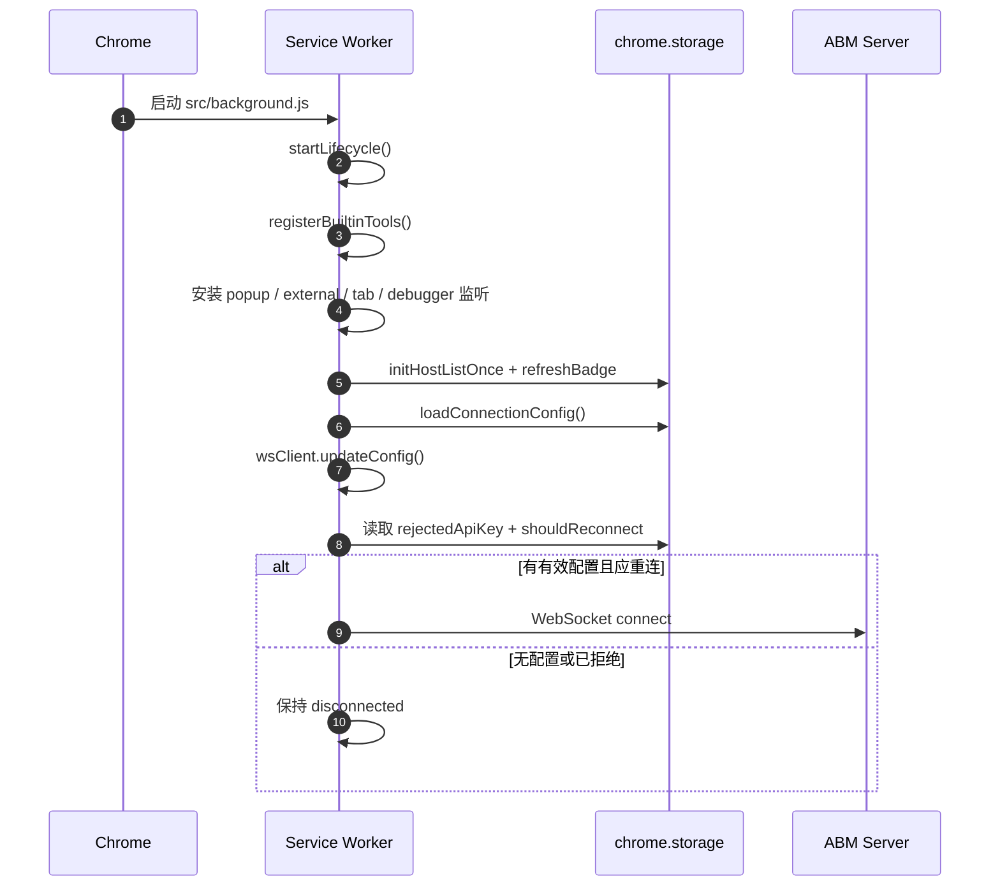

失败点：

- 配置读取失败 → 使用默认值。
- 被拒绝 Key 与当前 Key 相同 → 不自动连接。
- 权限/角标 API 失败 → 忽略，不阻塞连接。

## 2. Popup 保存配置并连接

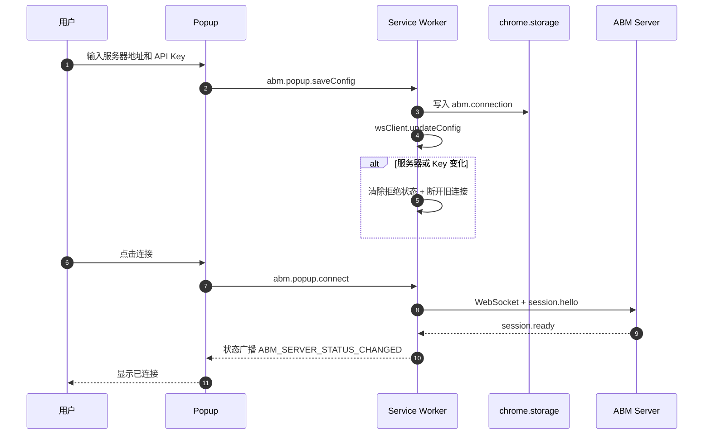

规则：

- 只切换“自动重连”不会断开现有连接。
- 修改服务器/Key 会断开旧连接。
- 连接状态通过 `chrome.runtime.sendMessage` 广播，popup 也可主动查询。

## 3. 握手、心跳与重连

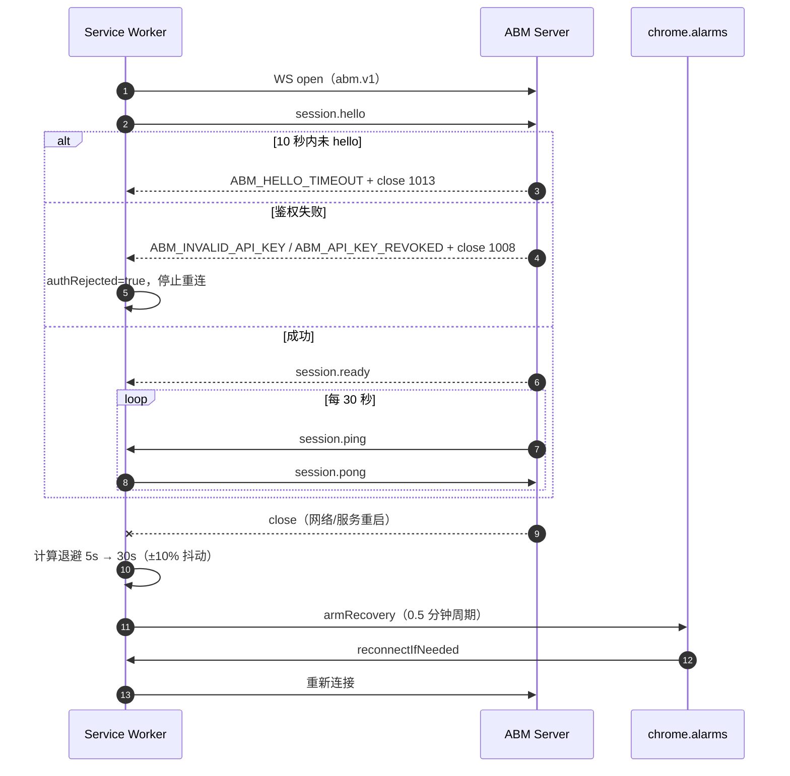

失败点：

- `session.ready` 15 秒超时 → 关闭并重试。
- 关闭码 1000/1008 → 不再自动重连。
- 连接卡在 connecting 超过 45 秒 → alarms 允许重新发起。
- Key 被拒绝后，用户更换 Key 才会清除拒绝状态。

## 4. 工具调用

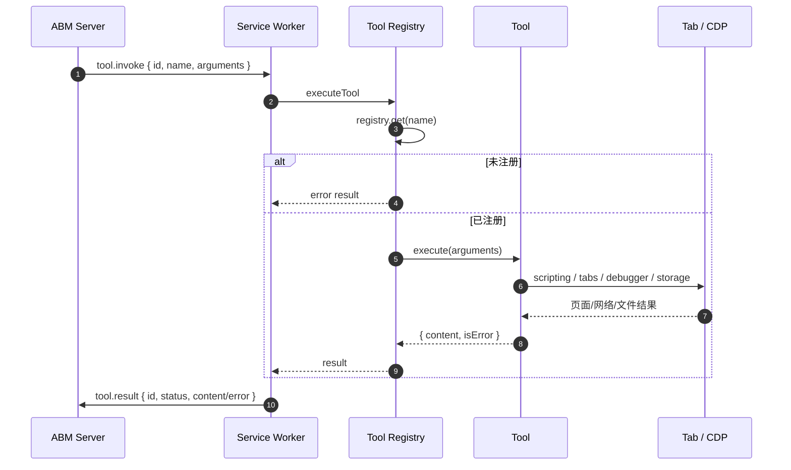

规则：

- 结果中的文本必须是字符串；非字符串会被 JSON 序列化。
- 工具异常统一包装为 `ABM_TOOL_EXECUTION_FAILED`。
- 相同 `tool.invoke` 的 `id` 原样回传，服务端据此完成 pending Future。

## 5. 导航与标签复用

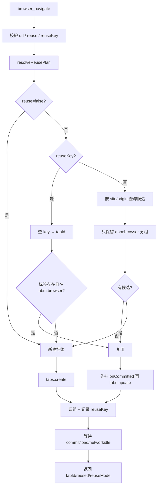

要点：

- 复用范围由目标 URL 推导，不维护站点枚举。
- `reuseKey` 标签关闭后按站点规则兜底重建。
- 自动分组失败不影响导航本身。
- 只复用 `abm:browser` 分组，不接管私人标签。

## 6. MAIN world 注入

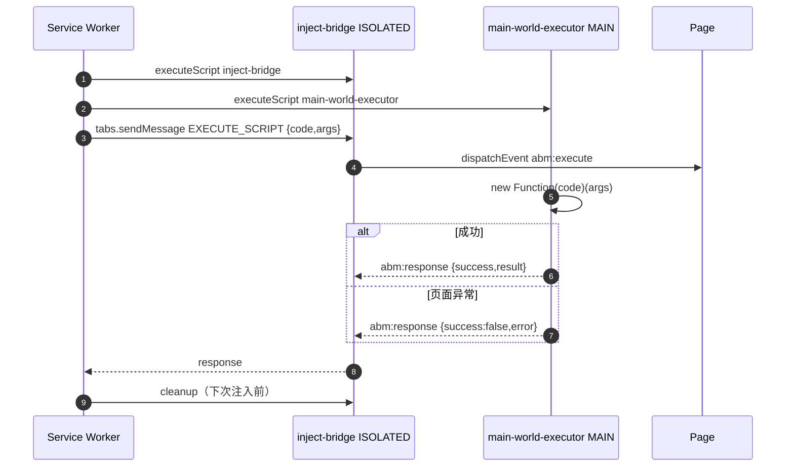

失败点：

- 页面没有监听器 → `chrome.runtime.lastError`。
- 页面 CSP 禁止 eval → `browser_inject_script` 走 CDP 兜底。
- 注入桥重复注入 → 首次注入前先 cleanup，避免监听器叠加。

## 7. 文件上传

### 7.1 Base64

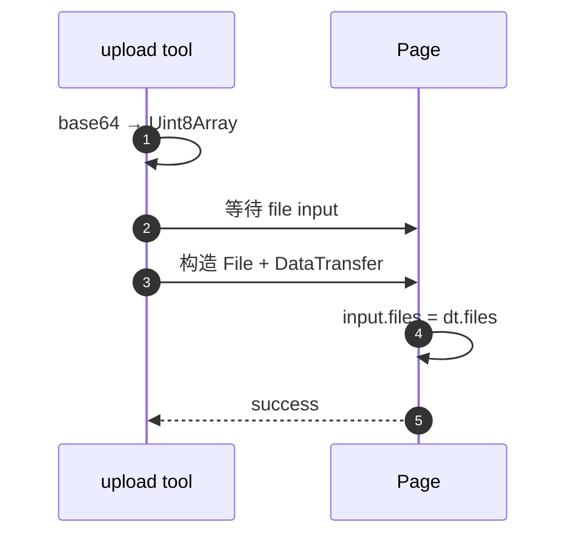

### 7.2 URL 文件

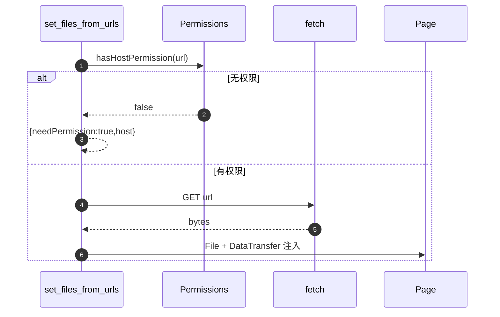

### 7.3 本机路径

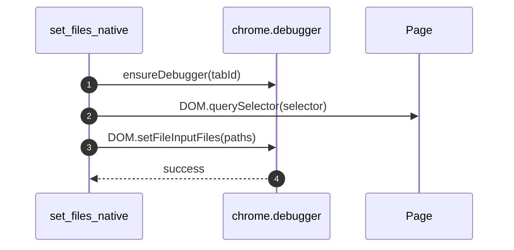

## 8. 网络抓包

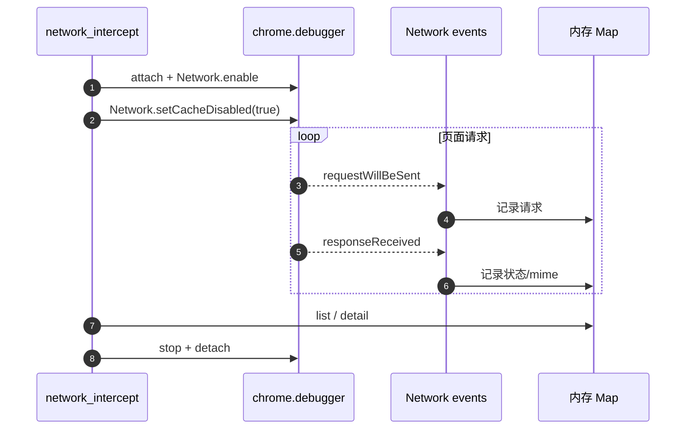

失败点：

- 页面关闭 / 调试器被外部断开 → 清理该 tab。
- 抓包数据只在 service worker 生命周期内有效。
- detail 响应体 >50KB 时 gzip + base64。

## 9. 视频桥

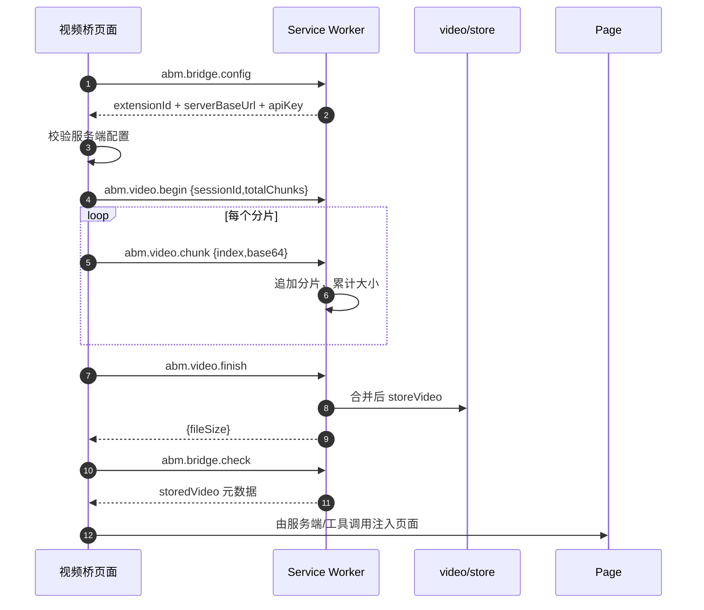

失败点：

- 来源不受信任 → 拒绝。
- 分片不完整 → finish 失败。
- 会话 30 分钟未完成 → 清理。
- 暂存区被 SW 回收 → 需要重新投递。

## 10. URL 视频下载

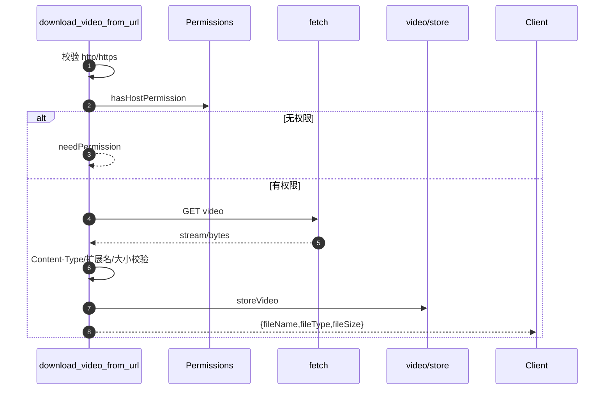

URL 源由扩展直接下载原始地址，服务端只传 URL，不接触视频字节。base64 源才由服务端临时托管；本机大文件优先使用 `browser_set_files_native`，只传绝对路径。

## 11. 通知

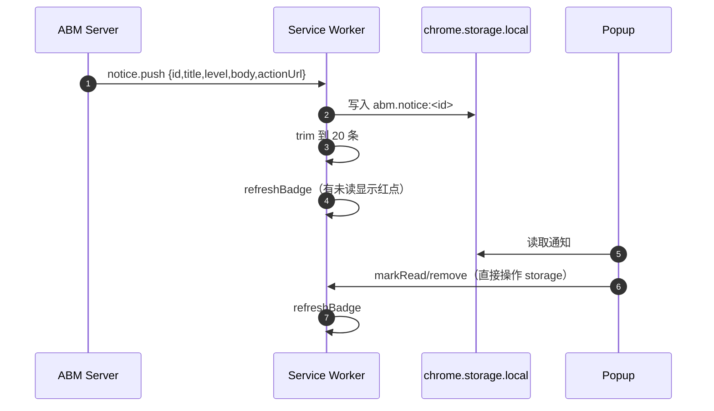

## 12. Key/账号失效传播

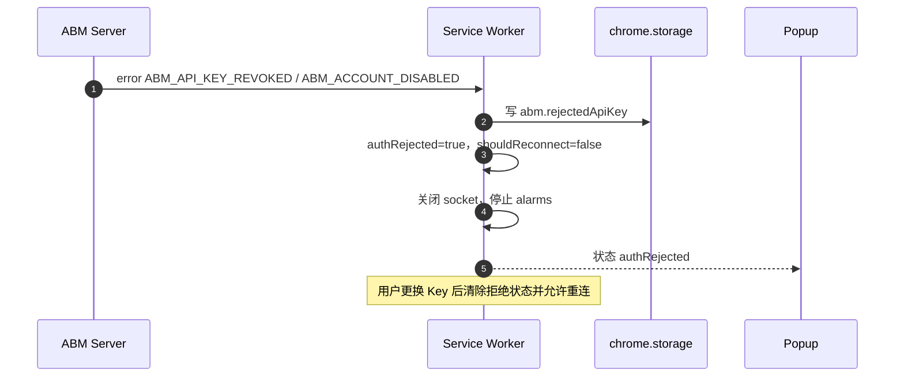

## 13. Service Worker 回收与恢复

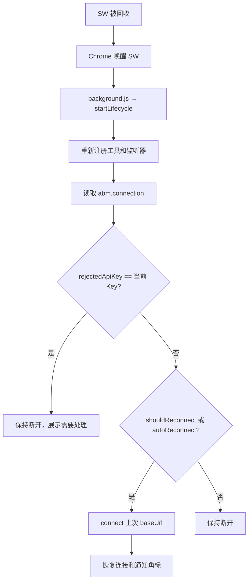

会丢失的状态：

- 视频暂存区。
- 网络抓包数据。
- 注入桥/CDP 附件（通过监听器和按需 attach 重建）。
- 视频桥上传会话。

会恢复的状态：

- 连接配置、拒绝 Key、自动分组、reuseKey、通知、host 权限。
- 连接意图（`storage.session` + alarms）。

## 14. 数据所有权

| 数据 | 位置 | 生命周期 |
|---|---|---|
| API Key | `abm.connection` | 用户删除/更换 |
| 连接状态 | 内存 + 广播 | 进程/连接期间 |
| 视频字节 | SW 内存 | 30 分钟 / 交付后 |
| 视频桥会话 | SW 内存 | 30 分钟 |
| 网络抓包 | SW 内存 | SW 生命周期 |
| 通知 | `chrome.storage.local` | 最近 20 条 |
| 自动分组 / reuseKey | `chrome.storage.local` | 持久 |
| host 权限 | Chrome permissions + storage | 用户撤销前 |
| 注入桥/CDP | 页面/调试器 | 标签/会话期间 |
