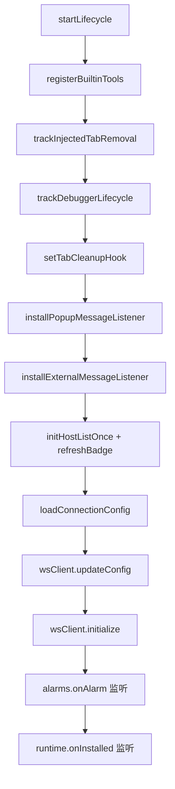
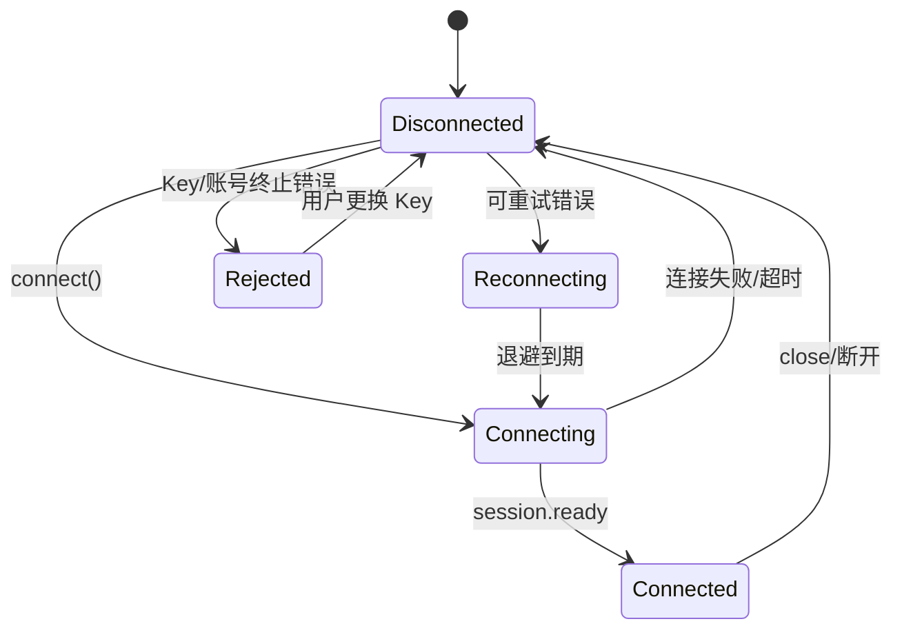
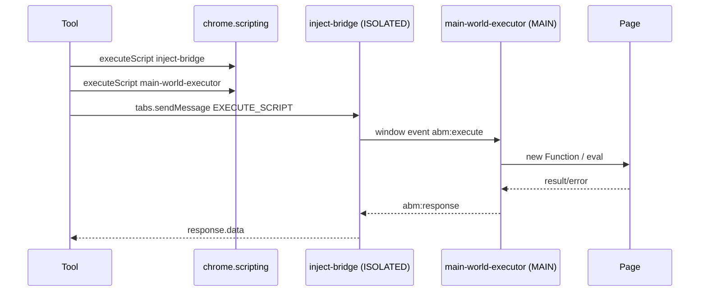

# ABM 浏览器扩展详细设计

> 本文描述 `browser-mcp-extension` 的内部实现。协议字段和服务端契约见 [architecture.md](architecture.md)。

## 1. 设计目标与约束

- Chrome Manifest V3，源码直接加载，无构建步骤。
- service worker 可被随时回收；所有长期状态必须可恢复或明确说明会丢失。
- 工具执行在用户本机，结果必须可序列化、可限制体积、可错误化。
- 页面内容不可信；API Key 不得进入页面或任意网站。
- 只执行已认证服务端下发的工具调用；不主动访问 ABM 服务之外的地址，除工具明确要求的目标 URL。

## 2. 启动流程

`src/background.js` 只做一件事：调用 `startLifecycle()`。

`core/lifecycle.js` 的初始化顺序：



要点：

- 工具注册必须在连接建立前完成，避免早到的 `tool.invoke` 找不到工具。
- `initHostListOnce` 清理旧的 host 列表并标记初始化。
- `refreshBadge` 恢复未读通知角标。
- `loadConnectionConfig` 会补全默认值并把 `ws://` / `wss://` 规范化为 `http://` / `https://`。
- `wsClient.initialize()` 读取持久配置、上次重连意图和被拒绝的 Key；满足条件时自动连接。
- `chrome.alarms` 每 0.5 分钟检查是否需要重连；Chrome 回收 service worker 后仍能恢复。

## 3. 连接状态机

`core/connection.js` 的 `WebSocketClient` 状态：



### 3.1 连接建立

1. 规范化 base URL，派生 `ws(s)://<host>/api/v1/extension/ws`。
2. 使用子协议 `abm.v1` 创建 WebSocket。
3. `open` 后发送 `session.hello`：
   ```json
   {"apiKey":"abm_...","extensionId":"...","extensionVersion":"2.0.2"}
   ```
4. 等待 `session.ready`，超时 15 秒。
5. 收到 `session.ready` 后：
   - 如果服务端返回的 `extensionId` 与本地不一致，发送 `session.identify` 纠正。
   - 状态改为 `connected`，重置退避，广播状态。

### 3.2 重连

- 初始延迟 5 秒，指数增长到 30 秒，带 ±10% 抖动。
- 重连意图写入 `chrome.storage.session`：
  - `abm.shouldReconnect`
  - `abm.currentBaseUrl`
- `chrome.alarms` 每 0.5 分钟调用 `reconnectIfNeeded`。
- `connecting` 状态超过 45 秒视为卡住，允许闹钟重新发起。
- 关闭码 1000 / 1008 停止自动重连。

### 3.3 终止错误与 Key 拒绝

`handleError(payload)`：

- `retryable=false`、`TERMINAL_ERROR_CODES`、或已处于拒绝状态 → 终止。
- `ABM_INVALID_API_KEY`、`ABM_API_KEY_REVOKED`、`ABM_ACCOUNT_DISABLED`：
  - 标记 `authRejected`。
  - 将 Key 写入 `abm.rejectedApiKey`。
  - 关闭 socket，停止重连。
  - popup 显示需要用户处理的状态。
- 其他终止错误（协议错误、重复 hello、连接替换）：
  - 关闭并停止重连，但不标记 Key 拒绝。

用户更换 Key 时 `updateConfig` 会清除拒绝状态、断开旧连接。

### 3.4 心跳与失活

- 服务端每 30 秒发 `session.ping`。
- 扩展收到后立即回 `session.pong`。
- 任意有效消息刷新服务端 `last_seen`；90 秒无活动服务端关闭。

## 4. 协议处理

`core/protocol.js`：

- `envelope(type, payload, id)` 构造 `{v:"abm/1", id, type, payload}`。
- `parseEnvelope(text)` 校验：
  - JSON 可解析。
  - `v === "abm/1"`。
  - `type` 是字符串。
  - `payload` 是对象。
- 解析失败返回 `null`，连接层记录“协议版本不兼容”。

`handleIncomingMessage` 分发：

| 类型 | 行为 |
|---|---|
| `session.ready` | 连接完成 |
| `session.ping` | 回 `session.pong` |
| `error` | 进入终止/重试逻辑 |
| `tool.invoke` | 执行工具并回 `tool.result` |
| `notice.push` | 保存通知、刷新角标 |
| 其他 | 忽略 |

`tool.invoke`：

```json
{"v":"abm/1","id":"call_x","type":"tool.invoke","payload":{"name":"browser_click","arguments":{}}}
```

`tool.result` 成功：

```json
{"v":"abm/1","id":"call_x","type":"tool.result","payload":{"status":"ok","content":[{"type":"text","text":"..."}]}}
```

失败：

```json
{"v":"abm/1","id":"call_x","type":"tool.result","payload":{"status":"error","error":{"code":"ABM_TOOL_EXECUTION_FAILED","message":"..."}}}
```

## 5. 工具注册与执行

`tools/registry.js`：

- `registerTool(tool)`：按 `tool.name` 写入 Map。
- `registerBuiltinTools()`：注册 19 个内置工具。
- `executeTool({name,args})`：
  - 找不到工具 → `{isError:true, content:[{type:"error",text:"Tool not found"}]}`。
  - 调用 `tool.execute(args)`，异常统一包成错误结果。

`tools/base.js`：

- `executeInTab(tabId, func, args, world)`：`chrome.scripting.executeScript`，默认 ISOLATED。
- `getActiveTab` / `getTargetTab`：显式 `tabId` 优先，否则当前活动标签。
- `waitForSelector`：100ms 轮询，页面导航期间忽略注入错误。
- `createTextResult` / `createErrorResult` / `invalidArgs`：统一结果格式。
- `describeInjectionError`：把 Chrome 注入错误整理成可读文本。

工具应返回结果而不是抛错；抛错会被注册表兜底，但会丢失工具上下文。

## 6. 工具目录与实现要点

### 6.1 页面与标签

| 工具 | 实现要点 |
|---|---|
| `browser_navigate` | URL 复用计划、自动分组、导航提交等待、load/DOMContentLoaded/networkidle |
| `browser_control` | `close_tab` / `get_tab` / `update_tab` / `query_tabs` / `activate_tab` |

`browser_navigate` 的复用计划来自 `reuse.js`：

- `site`：复用同主机标签，忽略 `www.` / `m.` / `mobile.`，不跨子域。
- `origin`：协议、主机、端口完全一致。
- `reuseKey`：专属标签映射，最多 50 个 key。
- 只复用 `abm:browser` 分组内的标签。
- 复用前先注册 `webNavigation.onCommitted`，再 `tabs.update`，避免旧文档 `complete` 误判。
- `networkidle` 额外等待连续 2 秒无 `webRequest.onCompleted`。

### 6.2 DOM 与交互

| 工具 | 实现要点 |
|---|---|
| `browser_click` | 选择器/文本匹配、可点击等待、点击后可选等待导航 |
| `browser_fill` | `set` / `type` / `execCommand`，支持 `clearBefore` |
| `browser_keyboard` | 聚焦元素后发送按键序列 |
| `browser_wait_elements` | 等待选择器数量达到指定值 |
| `browser_extract_data` | element/window/document、属性、全量 |
| `browser_read_page_data` | 读取 window 点分路径 |

### 6.3 脚本注入

`browser_inject_script`：

- 在 MAIN world 执行函数体或源码。
- 页面 CSP 禁止 eval 时，使用 CDP `Runtime.evaluate` 兜底。
- MV3 ISOLATED world 不能执行任意源码字符串；隔离世界只用于扩展内部桥和视频执行器。
- 执行后清理注入桥，避免重复监听。

注入链路：



### 6.4 文件上传

| 工具 | 实现 |
|---|---|
| `browser_upload_file` | 单个 base64 → `File` → `DataTransfer` → input.files |
| `browser_set_files` | 多个 base64 → 同上 |
| `browser_set_files_from_urls` | 先检查 host 权限，下载后转 File |
| `browser_set_files_native` | CDP `DOM.setFileInputFiles`，本机绝对路径 |

Base64 上传在页面主环境组装 `File`，不经过网络。URL 上传由扩展 `fetch`，因此需要目标域名权限；没有权限返回 `needPermission`，由 popup 引导授权。

### 6.5 网络抓包

`browser_network_intercept`：

- `start`：attach CDP，`Network.enable`，禁用缓存，记录 `requestWillBeSent` / `responseReceived`。
- `list`：按 URL 过滤内存中的请求。
- `detail`：读取响应体；超过 50KB 时 gzip + base64。
- `stop`：恢复缓存并 detach。
- 抓包数据只在 service worker 生命周期内有效。
- 标签关闭或调试器被外部断开时清理。

### 6.6 CDP 输入

| 工具 | 实现 |
|---|---|
| `browser_mouse_click` | `Input.dispatchMouseEvent` 按下/释放 |
| `browser_mouse_scroll` | `Input.dispatchMouseEvent` 滚轮 |
| `browser_input_sequence` | 按 `after` 延迟回放鼠标/键盘/文本事件 |
| `browser_set_files_native` | `DOM.setFileInputFiles` |

CDP 生命周期 `cdp.js`：

- attach 前先 detach 残留会话。
- attach 后用 `Runtime.evaluate` 探活，失败则重建。
- 命令超时 15 秒，探活超时 5 秒。
- 空闲 90 秒且无 in-flight 命令时自动 detach。
- 输入事件无响应时记录 60 秒冷却，避免重复卡死。
- 标签关闭 / `debugger.onDetach` 清理状态和工具钩子。

## 7. 视频子系统

### 7.1 暂存区

`video/store.js`：

- 内存单例 `storedVideo`：`{fileName, fileType, fileSize, data, storedAt}`。
- TTL 30 分钟；服务 worker 回收即丢失。
- 扩展侧上限 20GB；服务端默认 2GB，以服务端为准。
- `getStoredVideoInfo` 只返回元数据，不返回字节。
- 本机大文件优先走 `browser_set_files_native`，不进入暂存区。

### 7.2 Bridge 外部消息

`video/receiver.js` 只处理可信来源：

- 可信来源来自 `manifest.externally_connectable.matches`。
- 若 manifest 过于宽泛（`<all_urls>`），回退到 `DEFAULT_BRIDGE_KEY_PATTERNS`。
- 来源校验支持 `https://*.example.com/*`、端口通配等。

消息：

| 类型 | 行为 |
|---|---|
| `abm.bridge.check` | 返回扩展 ID、版本、暂存视频信息 |
| `abm.bridge.config` | 返回扩展 ID、服务地址、短期 bridge token；不返回 API Key |
| `abm.video.begin` | 创建上传会话 |
| `abm.video.chunk` | 追加 base64 分片 |
| `abm.video.finish` | 校验分片数、合并、写入暂存区 |
| `abm.video.cancel` | 删除会话 |
| `abm.video.info` | 返回暂存视频信息 |
| `abm.video.clear` | 清空暂存区 |

上传会话 30 分钟未完成自动清理。

控制台一键连接使用 `abm.connection.configure`：只有受信来源且 `sender.origin` 与 `payload.serverBaseUrl` 同源时才接受；扩展先保存 `abm.connection`，再发起 WebSocket 连接。视频消息仍由 `handleExternalMessage` 处理，非视频消息由 `core/external.js` 分发。

### 7.3 URL 下载

`browser_download_video_from_url`：

1. 校验 http/https。
2. 检查 host 权限；没有权限返回 `needPermission`。
3. `fetch` 下载，30 分钟超时，伪装常见浏览器 UA。
4. 校验 Content-Type / 扩展名白名单和大小上限。
5. 写入暂存区。

URL 源视频优先使用这条通道：服务端只传原始 URL，视频字节不经过服务器。base64 源才由服务端临时托管后交给扩展下载。本机文件优先使用 `browser_set_files_native`，只传绝对路径。

### 7.4 注入页面

`browser_set_video_to_page`：

1. 从暂存区取视频；没有则返回 `needUpload`。
2. 等待目标 file input。
3. 注入 `inject-bridge.js`（ISOLATED）和 `main-world-executor.js`（MAIN）。
4. MAIN world 初始化接收器。
5. 每片 20MB 通过 `tabs.sendMessage` 传入，页面显示进度 toast；toast 语言跟随 `abm.lang`，未设置时按 Chrome UI 语言（其他语言回退英文）。
6. MAIN world 组装 `File` 并写入 input。
7. `clearAfterSet=true` 时清空暂存区。

## 8. 权限管理

`permissions/manager.js`：

- manifest 静态 host 权限不可撤销，不进入管理列表。
- 本机地址（`127.0.0.1`、`localhost`）视为内置 host。
- 用户可单独添加域名，或一键授权 `<all_urls>`。
- 列表以浏览器实际持有的权限为准，storage 只作缓存：
  - `chrome.permissions.getAll()` 补回“已授权但未记账”的域名。
  - 权限弹窗关闭导致 storage 未写入时不会误报。
- 撤销域名会同时移除 storage 记录和浏览器权限。
- URL 下载/上传前必须调用 `hasHostPermission`。

## 9. 通知

`notices/manager.js`：

- 存储键：`abm.notice:<id>`。
- 对象：`{id,title,level,body,actionUrl,receivedAt,read}`。
- 同 id 幂等，不重复红点。
- 最多保留 20 条，超出删除最旧。
- `actionUrl` 只允许 http/https。
- 未读时 `chrome.action` 显示红点，全部已读后清空。
- popup 支持标记已读、删除、打开链接。

## 10. Popup 与配置

`popup/` 三个视图：

- **概览**：连接状态、服务器/Key 就地编辑、连接/断开、自动重连、通知。
- **权限**：下载域名列表、添加/移除、一键授权所有域名。
- **关于**：文档、仓库、问题反馈、视频桥入口。

消息类型见 `src/message-types.js`：

| 消息 | 作用 |
|---|---|
| `abm.popup.getStatus` | 连接状态 |
| `abm.popup.getConfig` / `saveConfig` | 读取/保存配置 |
| `abm.popup.connect` / `disconnect` | 连接控制 |
| `abm.popup.getPermissionStatus` | 权限状态 |
| `abm.popup.addHost` / `removeHost` | 域名权限 |
| `abm.popup.requestAllHosts` / `revokeAllHosts` | 全部域名权限 |
| `abm.popup.executeTool` | 调试/预览执行工具 |

配置保存在 `abm.connection`：

```json
{"serverBaseUrl":"https://abm.example.com","apiKey":"abm_...","autoReconnect":true}
```

修改服务器或 Key 会断开旧连接；只切换 `autoReconnect` 不会。

界面语言单独保存在 `abm.lang`（`zh` / `en`），首次打开按 Chrome UI 语言选择（其他语言回退 en）；popup 右上角的语言切换会立即重渲染状态、权限、通知和相对时间。扩展名称/描述由 `_locales/` 提供，随 Chrome 语言本地化。

## 11. 存储键与不变量

| 键 | 内容 | 生命周期 |
|---|---|---|
| `abm.connection` | 服务器、Key、自动重连 | 持久 |
| `abm.lang` | popup 语言 `zh` / `en` | 持久 |
| `abm.rejectedApiKey` | 被拒绝的 Key | 用户更换 Key 时清除 |
| `abm.shouldReconnect` | 是否应重连 | `storage.session` |
| `abm.currentBaseUrl` | 上次连接地址 | `storage.session` |
| `abm.automationGroupId` | 自动分组 ID | 持久 |
| `abm.reuseKeys` | reuseKey → tabId（最多 50） | 持久 |
| `abm.authorizedHosts` | 用户授权域名 | 持久 |
| `abm.allHostsAuthorized` | `<all_urls>` 标记 | 持久 |
| `abm.hostsInitialized` | 初始化标记 | 持久 |
| `abm.notice:<id>` | 单条通知 | 持久，最多 20 |
| `abm.bridgeKey` / `abm.bridgeExtensionId` | 桥缓存 | 持久 |

不变量：

- API Key 只存在 `abm.connection` 和内存配置中。
- 被拒绝的 Key 与当前 Key 相同则不再自动重连。
- 标签复用只作用于 `abm:browser` 分组。
- 通知和权限列表必须有上限/去重。
- 视频字节只在内存，不写入 storage。

## 12. 并发与 service worker 回收

- 所有网络/工具操作都是异步；同一连接上的工具调用由服务端 pending 表关联。
- CDP 命令有 in-flight 计数，空闲才 detach。
- 视频上传会话、网络抓包、注入桥、CDP 状态都在内存；service worker 回收后丢失。
- 连接恢复依赖 `storage.session` + `alarms`，不依赖内存。
- 标签关闭、调试器断开、页面导航都会触发清理钩子。
- 长任务（视频、下载、等待元素）必须设置超时，避免 SW 被回收时悬挂。

## 13. 错误与结果模型

- 工具内部错误 → `content:[{type:"error",text}]` + `isError:true`。
- 工具描述和工具错误消息使用英文规范文案；popup 与页面 toast 按 `abm.lang` 本地化。
- 注册表兜底异常 → `ABM_TOOL_EXECUTION_FAILED`。
- 连接层错误 → `error` 消息 + `ABM_*` 业务码 + 标准关闭码。
- 可重试错误 → 指数退避；终止错误 → 停止重连。
- 用户可操作错误：
  - `ABM_INVALID_API_KEY` / `ABM_API_KEY_REVOKED` → 打开账号门户。
  - `ABM_ACCOUNT_DISABLED` → 重新认证。
  - `ABM_CONNECTION_LIMIT` / `ABM_RATE_LIMITED` → 等待。
  - `ABM_PROTOCOL_ERROR` → 升级扩展。

## 14. 测试

| 测试 | 覆盖 |
|---|---|
| `test/protocol.test.mjs` | 信封、错误、关闭码、消息类型 |
| `test/parity.mjs` | 服务端/扩展工具名和契约一致性 |
| `test/navigate.test.mjs` | 标签复用、导航等待 |
| `test/reuse.test.mjs` | site/origin/key 复用纯函数 |
| `test/injection-contract.test.mjs` | ISOLATED/MAIN 注入契约 |
| `test/inject-script.test.mjs` | 注入脚本行为 |
| `test/bridge-video.test.mjs` | 视频桥消息、分片、完成 |
| `test/bridge-origin.test.mjs` | 可信来源校验 |
| `test/permissions.test.mjs` | host 权限、all_urls |
| `test/host-input.test.mjs` | 域名输入解析 |
| `test/storage.test.mjs` | 配置存取、默认值 |
| `test/popup-layout.test.mjs` | popup 视图与 DOM 契约 |
| `test/popup-i18n.test.mjs` | popup 中英文词典、manifest 本地化和预览依赖 |
| `test/manifest-key.test.mjs` | 扩展 ID/Key 一致性 |
| `test/icon.test.mjs` | 图标产物 |
| `test/release-*` | 发布流程 |

`npm run syntax` 检查全部 JS 和 manifest 引用；`npm test` 运行上述测试。

## 15. 修改指南

新增一个扩展工具：

1. 在 `src/tools/` 新建类，继承 `BaseTool`，实现 `name` 和 `execute`。
2. 在 `tools/registry.js` 注册。
3. 在服务端 `tools/browser.py` 定义同 Schema。
4. 更新 `test/parity.mjs`、协议测试和文档。
5. 在 Chrome 中验证标签/页面行为。

修改连接协议：

1. 更新 `constants.js`、`protocol.js`、`connection.js`。
2. 更新服务端 `extension_gateway/protocol.py` 与 gateway。
3. 更新两仓库契约测试。
4. 更新 `data-flow.md` 和 `scenarios.md`。

修改视频桥：

1. 更新 `video/receiver.js`、`constants.js` 和服务端视频服务。
2. 更新 `test/bridge-video.test.mjs`、`test/bridge-origin.test.mjs`。
3. 在真实 Chrome 中验证分片、进度、注入和权限。
